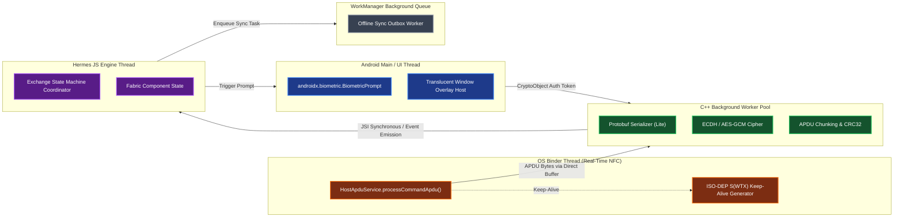

# BioTap Core ⚡

> **High-Assurance, Local-First NFC Contact Exchange Platform for Android**

[](https://developer.android.com)
[-000020.svg?style=flat-square&logo=expo&logoColor=white)](https://expo.dev)
[-61DAFB.svg?style=flat-square&logo=react&logoColor=black)](https://reactnative.dev)
[](https://kotlinlang.org)
[](https://protobuf.dev)
[](https://developer.android.com/training/sign-in/biometric-auth)
[](https://pnpm.io)

---

## 🌟 Executive Summary

**BioTap Core** is a high-engineering-caliber, local-first mobile contact sharing solution designed for Android. It enables two mobile devices (or an NFC smart token and a phone) to execute an ephemeral, cryptographically verified professional profile exchange with **zero foreground application overhead** prior to physical interaction.

### 🔑 Core Architectural Tenets

1. **Zero-Battery Idle**: Relies completely on low-level OS hardware dispatch registers (Android NFC Stack, Host Card Emulation ISO 7816-4 AID routing: `F00102030405`). Wakes the app directly from a dead/cold state upon physical 13.56 MHz RF induction without background polling daemons or location wake-locks.
2. **Hardware-Level Biometric Gatekeeping**: Private keys and payload transmission are locked behind Android KeyStore `StrongBox` / `TEE` keys configured with `setUserAuthenticationRequired(true)` and `AUTH_BIOMETRIC_STRONG`. Ciphers are bound to `androidx.biometric.BiometricPrompt.CryptoObject`.
3. **Assistant-Style Translucent Sheet UI**: Interception launches an ephemeral, translucent floating window (`Theme.BioTap.TranslucentOverlay`) hosting an interactive bottom drawer sliding smoothly over the active foreground app context.
4. **Decoupled Concurrency & Hard Real-Time Timing**: Hard latency-bounded ISO-DEP APDU transceiver loops run on the OS Binder thread with `S(WTX)` keep-alive negotiation. Heavy vCard/Protobuf parsing and AES-256-GCM cryptography are completely decoupled from UI and NFC loops.
5. **Zero-Rebuild DX with pnpm Monorepo**: TypeScript packages resolve directly from source files with modern `"moduleResolution": "bundler"`, enabling instant Fast Refresh and hot-reloading across workspace boundaries.

---

## 🏗️ Repository Architecture

Managed as an isolated `pnpm` monorepo:

```
biotap-core/
├── packages/
│   ├── biotap-proto/                  # Protocol Buffers wire framing & domain codecs
│   │   ├── src/biotap.proto           # ApduFrame, HandshakePayload, ContactProfile schemas
│   │   └── src/index.ts               # In-memory ProtoCodec & base64 utilities
│   └── biotap-native/                 # Custom Expo Native Module (Kotlin + C++)
│       ├── android/
│       │   ├── CMakeLists.txt         # Hardware CRC32 & C++ build
│       │   ├── src/main/AndroidManifest.xml # HCE service declaration
│       │   ├── src/main/res/xml/aids.xml # ISO 7816-4 AID registration (F00102030405)
│       │   ├── src/main/cpp/          # C++ ApduChunker & JNI bindings
│       │   └── src/main/java/         # Kotlin BioTapHceService, Gatekeeper, Overlay
│       └── src/index.ts               # BioTapHardwareManager TypeScript bindings
├── apps/
│   └── mobile/                        # Expo New Architecture Application (SDK 52)
│       ├── app.json                   # Android permissions, plugins, newArchEnabled
│       ├── App.tsx                    # Main dashboard & tap simulation
│       ├── src/components/AssistantSheet.tsx # Floating translucent bottom sheet
│       ├── src/services/StorageService.ts # expo-secure-store persistence
│       └── src/state/ExchangeCoordinator.ts # Reactive exchange state machine
└── docs/                              # Deep Technical Architecture Blueprints
```

---

## 📚 Technical Documentation Blueprints

Comprehensive architectural blueprints and system specifications are located in the [`docs/`](docs/) directory:

| Document | Focus & Highlights |
| :--- | :--- |
| **[01. System Component Architecture](docs/system-component-architecture.md)** | Hexagonal layer boundaries, 4-tier concurrency model, thread isolation, and language-agnostic interface definitions. |
| **[02. Hardware-to-UI Lifecycle Flow](docs/hardware-to-ui-lifecycle-flow.md)** | Cold wake-up sequence, window focus arbitration, ISO-DEP `S(WTX)` keep-alive protocol, and bidirectional state machines. |
| **[03. Edge Case Matrix & Resilience](docs/edge-case-matrix-and-resilience.md)** | Mid-tap RF pullaways, biometric lockouts, lockscreen (Keyguard) policies, and 3000ms deduplication sliding window. |
| **[04. Security & Cryptographic Architecture](docs/security-and-crypto-architecture.md)** | Hardware KeyStore / StrongBox key hierarchy, ephemeral P-256 ECDH, AES-256-GCM envelope encryption, and zeroization. |
| **[05. Android & Expo Technical Stack](docs/android-expo-technical-stack.md)** | Expo New Architecture (`newArchEnabled: true`), C++ TurboModule JSI bindings, Kotlin Expo Modules API, 5-thread Android topology. |
| **[06. Android Native HCE & Biometrics](docs/android-native-hce-biometrics.md)** | Low-level Android OS APIs: `HostApduService`, `BiometricPrompt.CryptoObject`, `TranslucentActivity`, and C++ APDU chunker. |
| **[07. Protocol Buffers Wire Specification](docs/proto/biotap.proto)** | Binary wire schema: `ApduFrame`, `HandshakePayload`, `EncryptedProfileEnvelope`, and `ContactProfile`. |

---

## ⚡ Concurrency & Threading Model



---

## 🚀 Quickstart

### Prerequisites
- **Node.js**: `v20.x` or higher (verified on Node `v26.x`)
- **pnpm**: `v10.x` or `v11.x`
- **Android SDK**: API Level 35 (`compileSdkVersion 35`, `minSdkVersion 26`)
- **Android NDK**: C++17 support with CMake 3.22+

### Installation & Typecheck

```bash
# Clone the repository
git clone https://github.com/inevitableDivu/biotap-core.git
cd biotap-core

# Install workspace dependencies
pnpm install

# Run global monorepo typecheck (resolves directly from TS source)
pnpm typecheck
```

### Running the Android Mobile App

```bash
# Start Metro bundler (monorepo watchFolders enabled)
pnpm start

# Run native Android build with Expo New Architecture
pnpm android
```

---

## 🔒 Security Threat Model

- **Anti-Skimming**: No profile bytes are emitted without an active `BiometricPrompt` hardware cryptographic assertion.
- **Forward Secrecy**: Handshakes derive ephemeral session keys via NIST P-256 ECDH; raw session keys are securely zeroized in memory post-transmission.
- **At-Rest Protection**: Local profiles and pairing records are envelope-encrypted using `expo-secure-store` backed by Android KeyStore `EncryptedSharedPreferences`.
- **Anti-Replay**: Each exchange exchanges fresh 256-bit cryptographically secure nonces validated during HKDF-SHA256 session key derivation.

---

## 📄 License

MIT © 2026 BioTap Core Contributors.
