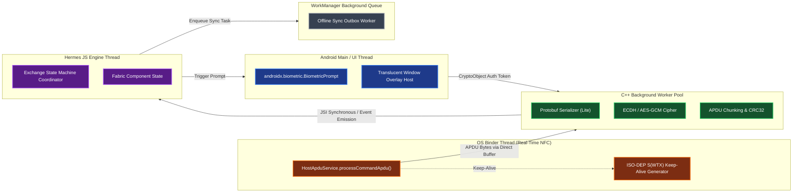

# Android & Expo Technical Stack Architecture

## 1. High-Level Technology Selection

This document formalizes the production architecture for **BioTap Core** targeted exclusively at **Android**, built upon the **Expo SDK (Latest / SDK 52+) New Architecture** (`newArchEnabled: true`) and extended with a dual native layer in **Kotlin** and **C++**.

```
┌────────────────────────────────────────────────────────────────────────────┐
│                    React Native Presentation Layer                         │
│  - React 18+ Concurrent Features / Hermes Engine                          │
│  - React Native Fabric UI (Assistant Bottom Sheet Animation)               │
│  - Unidirectional State Management (Zustand / XState FSM)                  │
└─────────────────────────────────────┬──────────────────────────────────────┘
                                      │ JSI (Zero-Copy Direct Memory C++ Calls)
                                      ▼
┌────────────────────────────────────────────────────────────────────────────┐
│              C++ Core Engine (JSI / Cxx TurboModule Layer)                 │
│  - Protocol Buffers Lite (biotap.v1.ApduFrame / ContactProfile)            │
│  - APDU Frame Chunking, Reassembly, & CRC32 Integrity Checking             │
│  - Ephemeral Cryptographic Engine (OpenSSL / BoringSSL: ECDH P-256)       │
└─────────────────────────────────────┬──────────────────────────────────────┘
                                      │ JNI / Native C++ to Kotlin Bindings
                                      ▼
┌────────────────────────────────────────────────────────────────────────────┐
│                   Kotlin Native Layer (Expo Modules API)                   │
│  - Android HostApduService (HCE ISO 7816-4 AID Dispatch: F00102030405)     │
│  - Android NfcAdapter ReaderMode (IsoDep Transceiver Loop)                 │
│  - AndroidX BiometricPrompt with Hardware CryptoObject Binding             │
│  - Translucent Overlay Activity & Window Focus Arbitrator                  │
│  - Android WorkManager for Guaranteed Offline-to-Cloud Sync                │
└─────────────────────────────────────┬──────────────────────────────────────┘
                                      │ Android Hardware Abstraction
                                      ▼
┌────────────────────────────────────────────────────────────────────────────┐
│                    Android Native OS & Hardware Roots                      │
│  - Android KeyStore (StrongBox / TEE Hardware Isolated Security)           │
│  - expo-secure-store (EncryptedSharedPreferences for At-Rest Credentials) │
│  - Android NFC Hardware Controller (PN553 / NXP / Broadcom RF Core)        │
└────────────────────────────────────────────────────────────────────────────┘
```

---

## 2. Why the Dual Kotlin + C++ Extension Paradigm?

| Responsibility                             | Language                           | Architectural Justification                                                                                                                                                                       |
| :----------------------------------------- | :--------------------------------- | :------------------------------------------------------------------------------------------------------------------------------------------------------------------------------------------------ |
| **Android Hardware & Lifecycle Hooks**     | **Kotlin**                         | NFC `HostApduService`, `NfcAdapter.ReaderCallback`, `BiometricPrompt`, and Android `WindowManager` are first-class Android SDK APIs requiring lifecycle-aware Android `Context` and binder hooks. |
| **Protocol Buffers & APDU Frame Chunking** | **C++ (JSI)**                      | Raw APDU byte arrays must be packetized, validated with CRC32, and marshaled between Protobuf binary wire format and Hermes without JSON bridge serialization overhead.                           |
| **Microsecond Cryptography**               | **C++ (JSI)**                      | Ephemeral NIST P-256 ECDH key derivation and AES-256-GCM symmetric block ciphering execute at bare-metal speed with direct `jsi::ArrayBuffer` zero-copy memory access.                            |
| **Persistent Identity & Token Storage**    | **`expo-secure-store` & KeyStore** | Manages encrypted at-rest storage backed by the Android KeyStore master key without rolling custom file encryption.                                                                               |

---

## 3. Native Threading Topology on Android

React Native applications on Android often suffer from frame drops if native events block the main thread. In BioTap Core, thread boundaries are strictly partitioned:



### Critical Concurrency Guarantee:

- `HostApduService.processCommandApdu()` executes on the OS **NFC Binder Thread**.
- It **never blocks** waiting for Hermes JS or `BiometricPrompt`.
- While the biometric prompt is displayed on the Android Main Thread, the Binder thread returns ISO-DEP `S(WTX)` frames to satisfy the remote terminal's RF polling window.

---

## 4. Hardware Biometrics & Key Storage Architecture

### 4.1. `expo-secure-store` vs Hardware-Gated `CryptoObject`

The project uses a hybrid security model:

1. **`expo-secure-store`**:
   - Used in TypeScript for storing user profile settings, remote API sync tokens, public identity metadata, and database passphrases.
   - Backed by Android KeyStore `EncryptedSharedPreferences`.
2. **Native Kotlin `BiometricPrompt.CryptoObject`**:
   - Required for real-time NFC gating.
   - Generates a dedicated biometric-bound private key inside Android KeyStore:
     ```kotlin
     KeyGenParameterSpec.Builder(KEY_ALIAS, KeyProperties.PURPOSE_ENCRYPT or KeyProperties.PURPOSE_DECRYPT)
         .setBlockModes(KeyProperties.BLOCK_MODE_GCM)
         .setEncryptionPaddings(KeyProperties.ENCRYPTION_PADDING_NONE)
         .setUserAuthenticationRequired(true)
         .setUserAuthenticationParameters(0, KeyProperties.AUTH_BIOMETRIC_STRONG)
         .setInvalidatedByBiometricEnrollment(true)
         .build()
     ```
   - When the user taps the device, a cipher is initialized with this key and wrapped into `BiometricPrompt.CryptoObject(cipher)`.
   - The cipher can **only** be used to sign or decrypt the handshake once the physical sensor validates the user.

---

## 5. Repository & Project Directory Structure

```
biotap-core/
├── docs/                                  # Architectural specifications
│   ├── proto/
│   │   └── biotap.proto                   # Protocol Buffers wire & domain schema
│   ├── README.md
│   ├── system-component-architecture.md
│   ├── hardware-to-ui-lifecycle-flow.md
│   ├── edge-case-matrix-and-resilience.md
│   ├── security-and-crypto-architecture.md
│   ├── android-expo-technical-stack.md
│   └── android-native-hce-biometrics.md
├── packages/
│   ├── biotap-native/                     # Custom Expo Module (Kotlin + C++)
│   │   ├── android/
│   │   │   ├── build.gradle
│   │   │   ├── CMakeLists.txt             # C++ JSI / Protobuf build script
│   │   │   └── src/main/
│   │   │       ├── AndroidManifest.xml    # HCE service & NFC declaration
│   │   │       ├── res/xml/
│   │   │       │   └── aids.xml           # ISO 7816-4 AID registration
│   │   │       ├── cpp/                   # High-performance C++ core
│   │   │       │   ├── jsi_bindings.cpp   # JSI TurboModule bindings
│   │   │       │   ├── proto/             # Compiled biotap.pb.h / biotap.pb.cc
│   │   │       │   ├── apdu_chunker.hpp   # APDU frame fragmentation & CRC32
│   │   │       │   └── crypto_engine.hpp  # BoringSSL / P-256 ECDH
│   │   │       └── java/com/biotap/native/
│   │   │           ├── BioTapModule.kt    # Expo Module API entrypoint
│   │   │           ├── hce/
│   │   │           │   └── BioTapHceService.kt  # Android HostApduService
│   │   │           ├── nfc/
│   │   │           │   └── BioTapReaderManager.kt # ReaderMode & IsoDep
│   │   │           ├── biometric/
│   │   │           │   └── BiometricGatekeeper.kt # BiometricPrompt & CryptoObject
│   │   │           └── overlay/
│   │   │               └── TranslucentActivity.kt # Assistant window wrapper
│   │   ├── src/                           # TypeScript native bindings
│   │   │   ├── index.ts                   # Exported native module methods
│   │   │   └── BioTapNative.types.ts
│   │   └── expo-module.config.json
│   └── biotap-app/                        # Expo Application (React Native)
│       ├── app.json                       # Config plugins & permissions
│       ├── package.json
│       ├── src/
│       │   ├── components/                # Fabric UI components
│       │   │   ├── AssistantSheet.tsx     # Translucent bottom sheet
│       │   │   └── BiometricFeedback.tsx
│       │   ├── state/                     # State machine & stores
│       │   │   └── useExchangeCoordinator.ts
│       │   └── storage/                   # expo-secure-store & SQLite
│       │       └── SecureKeyStorage.ts
```

---

## 6. Zero-Battery Android Manifest Configuration

To wake the app from dead cold state without background battery drain, the native module injects the following configuration into the host Android manifest:

```xml
<manifest xmlns:android="http://schemas.android.com/apk/res/android">
    <uses-permission android:name="android.permission.NFC" />
    <uses-permission android:name="android.permission.USE_BIOMETRIC" />
    <uses-feature android:name="android.hardware.nfc" android:required="true" />
    <uses-feature android:name="android.hardware.nfc.hce" android:required="true" />
    <uses-feature android:name="android.hardware.fingerprint" android:required="false" />

    <application>
        <!-- Host Card Emulation Service for Zero-Battery Interaction -->
        <service
            android:name="com.biotap.native.hce.BioTapHceService"
            android:exported="true"
            android:permission="android.permission.BIND_NFC_SERVICE">
            <intent-filter>
                <action android:name="android.nfc.cardemulation.action.HOST_APDU_SERVICE" />
            </intent-filter>
            <meta-data
                android:name="android.nfc.cardemulation.host_apdu_service"
                android:resource="@xml/aids" />
        </service>

        <!-- Translucent Overlay Assistant Activity -->
        <activity
            android:name="com.biotap.native.overlay.TranslucentActivity"
            android:theme="@style/Theme.BioTap.TranslucentOverlay"
            android:launchMode="singleInstance"
            android:excludeFromRecents="true"
            android:exported="false"
            android:configChanges="orientation|screenSize|screenLayout|keyboardHidden"
            android:windowSoftInputMode="adjustNothing" />
    </application>
</manifest>
```

And `@xml/aids`:

```xml
<host-apdu-service xmlns:android="http://schemas.android.com/apk/res/android"
    android:description="@string/hce_service_desc"
    android:requireDeviceUnlock="false">
    <aid-group
        android:description="@string/aid_group_desc"
        android:category="other">
        <!-- BioTap Core AID: F00102030405 -->
        <aid-filter android:name="F00102030405" />
    </aid-group>
</host-apdu-service>
```
