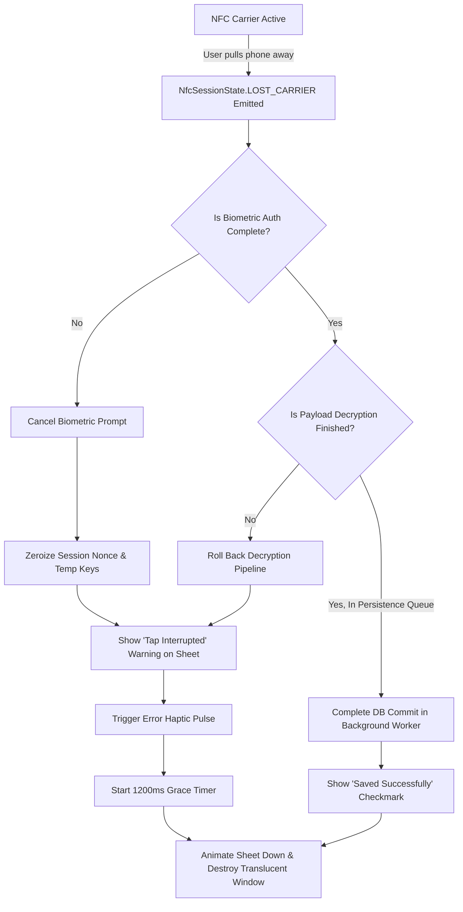

# Edge Case Matrix & Resilience Strategy

## 1. Overview & Fault Tolerance Philosophy

In a physical peer-to-peer interaction environment (NFC RF coupling, moving human hands, ambient interference, and hardware security enclaves), non-ideal execution paths are common. BioTap Core adheres to the **Fault-Tolerant, Non-Destructive Ingestion Principle**:

- **Atomic Rollbacks**: Any interrupted physical exchange leaves zero partial, corrupt, or unverified records in the database.
- **Idempotency**: Accidental double-taps or rapid reconnection attempts within a temporal window must resolve idempotently without duplicating contact records.
- **Clean Window Recovery**: Under no circumstance may an orphaned translucent window or unresponsive biometric dialog linger over the user's screen.

---

## 2. Comprehensive Edge Case Matrix

| Fault Category        | Specific Edge Case                                         | Trigger Condition                                                                                 | System Behavior & Failure Detection                                                          | Recovery & Mitigation Strategy                                                                                                                                                                                                                                   |
| :-------------------- | :--------------------------------------------------------- | :------------------------------------------------------------------------------------------------ | :------------------------------------------------------------------------------------------- | :--------------------------------------------------------------------------------------------------------------------------------------------------------------------------------------------------------------------------------------------------------------- |
| **Physical RF Layer** | **Early RF Decouple (Mid-Tap Pullaway)**                   | User pulls phone away while APDU frames or biometric validation are in progress.                  | Native NFC driver emits `NfcSessionState.LOST_CARRIER` or ISO-DEP timeout (SW=0x6F00).       | 1. Abort active APDU transceiver loop immediately.<br/>2. Transition sheet to "Tap Lost" visual state.<br/>3. Discard unverified ephemeral symmetric keys.<br/>4. Auto-dismiss overlay after 1500ms with warning haptic pulse.                                   |
| **Physical RF Layer** | **Partial / Corrupted APDU Stream**                        | Electromagnetic noise or partial separation causes truncated frame delivery.                      | APDU frame parser detects CRC32 checksum mismatch or frame length less than expected header. | 1. Drop corrupted frame.<br/>2. Transceiver requests immediate frame re-transmission (up to 2 retries within 150ms).<br/>3. If retries exhausted, signal exchange failure and abort.                                                                             |
| **Physical RF Layer** | **Multi-Tag Collision**                                    | Multiple NFC tokens/cards (e.g., transit card in phone case) detected in RF field simultaneously. | OS NFC controller triggers collision resolution error (`ISO14443_4A_COLLISION`).             | 1. Suppress generic system dialogs.<br/>2. Present explicit sheet cue: _"Multiple NFC cards detected. Please isolate phone from wallet/cards."_<br/>3. Auto-dismiss after 3000ms.                                                                                |
| **Physical RF Layer** | **Rapid Double-Tap (Bouncing)**                            | User taps, pulls away, and taps again within a 500ms–1500ms window.                               | New hardware NFC wake-up event fires while previous session is closing or persisted.         | 1. Calculate incoming payload hash / peer identity fingerprint.<br/>2. In-memory deduplication cache checks fingerprint against active 3000ms sliding window.<br/>3. If duplicate, show instant "Already Shared" checkmark without re-running crypto/biometrics. |
| **Biometric Gate**    | **User Explicit Cancellation**                             | User taps outside biometric prompt, taps "Cancel", or swipes overlay away.                        | `IBiometricGatekeeper` emits `BiometricError.USER_CANCELED`.                                 | 1. Immediately abort NFC transceiver and release APDU channel.<br/>2. Clear and zeroize in-memory cryptographic keys.<br/>3. Animate sheet downward smoothly (200ms) and release window focus.                                                                   |
| **Biometric Gate**    | **Sensor Mismatch / Recognition Failure**                  | Fingerprint unreadable or Face ID fails repeatedly.                                               | OS biometric provider triggers sensor failure callback (`ERROR_UNABLE_TO_PROCESS`).          | 1. Keep sheet active; display inline retry feedback.<br/>2. Maintain RF coupling using ISO-DEP `S(WTX)` frames.<br/>3. Allow OS-managed native retry count (typically 3–5 attempts).                                                                             |
| **Biometric Gate**    | **Biometric Lockout**                                      | Too many failed biometric attempts trigger temporary or permanent device lockout.                 | `IBiometricGatekeeper` emits `ERROR_LOCKOUT` or `ERROR_LOCKOUT_PERMANENT`.                   | 1. If policy allows, fall back gracefully to Device Passcode/PIN prompt.<br/>2. If passcode fallback fails or is disallowed, tear down overlay with persistent lockout error message.<br/>3. Release all hardware handles.                                       |
| **Biometric Gate**    | **Enclave Key Invalidation (Biometric Enrollment Change)** | User enrolled a new fingerprint or reset Face ID in system settings after app key creation.       | Hardware KeyStore throws `KeyPermanentlyInvalidatedException` upon crypto cipher init.       | 1. Catch exception during cipher initialization.<br/>2. Automatically revoke and re-generate device identity keypair in Secure Enclave.<br/>3. Request fresh biometric authorization for the new keypair.                                                        |
| **OS & Window**       | **Tap When Screen Is Locked (Keyguard Active)**            | Device is physically locked in pocket or locked state when external NFC tap occurs.               | OS reports `KeyguardManager.isDeviceLocked() == true`.                                       | 1. Do NOT show standard overlay.<br/>2. Request system `FLAG_SHOW_WHEN_LOCKED` window policy.<br/>3. Require full biometric unlock before profile decryption or ingestion.<br/>4. Do NOT expose sensitive contact fields on lockscreen overlay.                  |
| **OS & Window**       | **Device Orientation / Foldable Unfolding**                | User rotates device or unfolds foldable screen mid-biometric/mid-transfer.                        | Window manager fires configuration change (`onConfigurationChanged`).                        | 1. Lock overlay window orientation to current configuration upon wake-up.<br/>2. Maintain persistent Coordinator state independently of UI View recreation.<br/>3. Re-bind View to existing coordinator stream without resetting handshake.                      |
| **OS & Window**       | **High-Priority OS Interruption**                          | Incoming phone call, emergency alert, or alarm fires during tap.                                  | Window manager revokes window focus (`onWindowFocusChanged(false)`).                         | 1. Immediately terminate active NFC session to avoid half-open states.<br/>2. Roll back uncommitted database transactions.<br/>3. Dismiss translucent window silently in background.                                                                             |
| **OS & Window**       | **Low-Memory Killer (LMK) Process Murder**                 | System under critical memory pressure kills the app process mid-transaction.                      | Kernel sends `SIGKILL` without prior lifecycle warning.                                      | 1. SQLite Write-Ahead Logging (WAL) ensures database consistency remains intact.<br/>2. On next cold-boot, database automatically recovers clean state.<br/>3. In-flight session is treated as clean abort.                                                      |
| **Data & Storage**    | **Disk Full / Storage Exhaustion**                         | Device storage is 100% full; SQLite cannot write WAL journal frame.                               | Transactional store throws `SQLiteFullException` or `ENOSPC`.                                | 1. Roll back memory transaction.<br/>2. Display sheet warning: _"Storage Full: Profile could not be saved."_<br/>3. Retain payload temporarily in transient memory cache if user chooses to export immediately.                                                  |
| **Data & Storage**    | **Malicious / Malformed Payload (Payload Bomb)**           | Malicious actor attempts to inject 50MB vCard, gzip bomb, or executable shellcode over NFC.       | Payload Processor validation fails schema bounds (payload > 64KB, nested structures > 10).   | 1. Strictly enforce max payload size limit (≤ 64 KB).<br/>2. Reject payload immediately with `ValidationError.PAYLOAD_SIZE_EXCEEDED`.<br/>3. Discard raw bytes without writing to disk or parsing into memory DOM.                                               |

---

## 3. Resilience Architectural Workflows

### 3.1. Physical Decouple Recovery (Early Pullaway)

When a user pulls the phone away prematurely, the RF link is severed. Rather than leaving the user in an ambiguous state, the system employs a deterministic state-unwinding sequence:



---

### 3.2. Secure Keyguard / Lockscreen Protocol

Handling interactions on locked devices requires adhering to strict platform privacy guidelines:

1. **Information Concealment**:
   - If `isDeviceLocked() == true`, the assistant sheet renders in **Redacted Mode**:
   - Displays only: generic avatar placeholder, _"BioTap Contact Exchange"_ label, and biometric prompt.
   - Company name, email, phone number, and professional notes are strictly obscured until the biometric key authenticates.
2. **Keyguard Bypassing Prevention**:
   - The translucent window must never allow touch events to bleed into the underlying locked system.
   - Dismissing the sheet without authenticating returns the device directly to the ambient lockscreen without unlocking the device or revealing home screen contents.

---

### 3.3. Transactional Integrity & Idempotency Engine

To prevent contact duplication when users tap repeatedly in quick succession:

```typescript
interface IdempotencyRecord {
  payloadFingerprint: string; // SHA-256(peerPublicKey + peerProfileTimestamp)
  firstSeenTimestamp: int64;
  committedProfileId: UUID;
}

class IngestionDeduplicationEngine {
  private readonly memoryCache: LruCache<string, IdempotencyRecord>;
  private readonly DEDUP_WINDOW_MS: int64 = 3000; // 3-second deduplication threshold

  public checkAndRegister(fingerprint: string): DedupResult {
    const existing = this.memoryCache.get(fingerprint);
    const now = SystemClock.currentMonotonicMillis();

    if (existing && now - existing.firstSeenTimestamp < this.DEDUP_WINDOW_MS) {
      return DedupResult.duplicate(existing.committedProfileId);
    }

    return DedupResult.unique();
  }
}
```

- When a tap occurs, the payload fingerprint is evaluated **before** database transaction creation.
- If recognized within the 3-second window, the system immediately presents the success state without executing redundant SQLite transactions or invoking duplicate OS background sync jobs.
