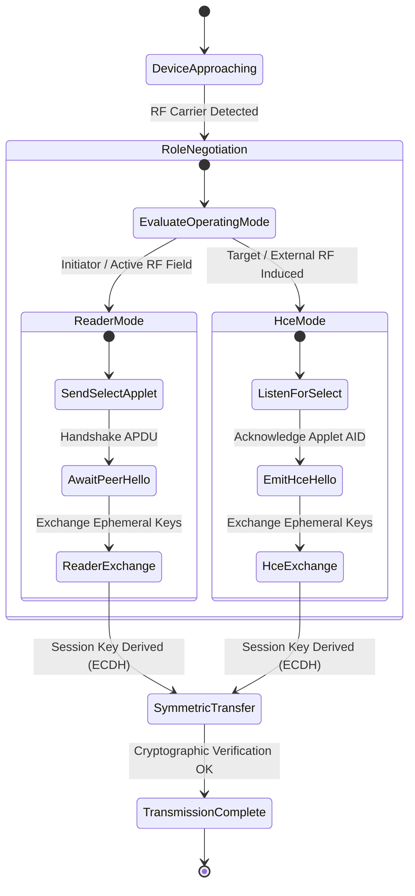

# Hardware-to-UI Lifecycle Flow & Execution Sequence

## 1. End-to-End Execution Flow Overview

The BioTap Core lifecycle spans five distinct operational phases:

1. **Zero-Power Hardware Wakeup**: Native OS kernel/NFC controller detects an RF field and routes the interaction based on pre-registered Application IDs (AIDs) or NDEF record filters.
2. **Overlay Mounting & Focus Acquisition**: The OS launches an ephemeral, translucent window hosting an assistant-style bottom sheet without tearing down the underlying foreground application.
3. **Hardware Biometric Gatekeeping**: The presentation layer triggers an automatic hardware-backed biometric verification prompt, gating the cryptographic keys within the Secure Enclave/KeyStore.
4. **RF Coupling & Secure Payload Transmission**: Data is exchanged using ISO-DEP (ISO 14443-4) APDU frames, utilizing Wait Time Extension (WTX) packets to sustain the RF carrier during biometric authentication.
5. **Decoupled Persistence & Smooth Dismissal**: The payload is handed off to off-thread compute workers and transactional disk queues while the UI sheet animates down, cleanly restoring focus to the previous application.

---

## 2. Comprehensive Sequence Diagram

```mermaid
sequenceDiagram
    autonumber
    actor Peer as Remote Peer / NFC Tag
    participant NFC_HW as OS NFC Controller (Kernel)
    participant Overlay as Translucent Window Host
    participant SheetUI as Assistant Sheet View
    participant BioPrompt as OS Biometric Subsystem
    participant Coord as Exchange Session Coordinator
    participant Crypto as Crypto Engine & Enclave
    participant Store as Transactional Data Store
    participant BgJob as OS Background Scheduler

    Note over NFC_HW: App is completely DEAD (Cold State)<br/>Zero Background CPU/Battery Drain
    Peer->>NFC_HW: Physical Tap (13.56 MHz RF Field Induced)
    NFC_HW->>NFC_HW: Match AID (F00102030405) or NDEF Filter
    NFC_HW->>Coord: Cold-Boot Dispatch Intent / APDU Service Bind

    activate Coord
    Coord->>Overlay: Initialize Translucent Window Token
    activate Overlay
    Overlay->>SheetUI: Mount View & Animate Slide-Up (0-300ms)
    activate SheetUI

    Overlay->>Overlay: Request Input Focus (Dismiss Dim Lock)
    SheetUI->>BioPrompt: Trigger Hardware Biometric Prompt
    activate BioPrompt

    par Maintain RF Carrier Coupling
        loop While Biometric Pending (Keep-Alive)
            Peer->>Coord: Inbound APDU Request / Ping
            Coord->>Peer: ISO-DEP S(WTX) Frame (Wait Time Extension)
        end
    and Capture User Biometrics
        actor User as Local Device User
        User->>BioPrompt: Fingerprint / Face ID Presented
        BioPrompt->>Crypto: Unlock Enclave Crypto Handle (KeyStore)
        BioPrompt-->>SheetUI: Biometric Authenticated (Success)
    end
    deactivate BioPrompt

    SheetUI->>Coord: Emit BiometricAuthorized Token
    Coord->>Crypto: Initialize Ephemeral ECDH & Generate Nonce
    Crypto-->>Coord: Public Key (P-256) + Nonce

    rect rgb(20, 30, 45)
        Note over Coord, Peer: Bidirectional Cryptographic Exchange
        Coord->>Peer: Send Public Key + Handshake Nonce
        Peer->>Coord: Return Peer Public Key + Encrypted Payload Bundle
        Coord->>Crypto: Derive AES-256 Session Key (HKDF) & Decrypt
        Crypto-->>Coord: Verified Decrypted Contact Bytes
    end

    Coord->>SheetUI: Emit ExchangeComplete (Trigger Success Haptic)
    SheetUI->>SheetUI: Animate Checkmark & Slide Down (300ms)

    par Asynchronous Persistence (Off-Thread)
        Coord->>Store: Atomic Commit Profile to Local DB (WAL)
        activate Store
        Store-->>Coord: Transaction Committed
        deactivate Store
        Coord->>BgJob: Enqueue Sync Outbox Task (WorkManager/BGTask)
    and UI Tear Down & Restoration
        SheetUI->>Overlay: Animation Complete
        deactivate SheetUI
        Overlay->>Overlay: Destroy Window & Release Focus
        deactivate Overlay
    end

    deactivate Coord
    Note over Overlay: User returned to original background app uninterrupted
```



---

## 3. Detailed Phase Breakdown

### Phase 1: Zero-Battery Idle & OS Hardware Dispatch

To prevent background battery consumption, the application registers static hardware dispatch hooks in the operating system application manifest:

- **Host Card Emulation (HCE) Mode**: Declares an ISO/IEC 7816-4 Application ID (AID) routing filter (e.g., AID `F0 01 02 03 04 05`). The OS NFC stack routes incoming APDU commands directly to the registered service without waking the application before physical contact.
- **Polling Reader Mode**: Registers an OS-level NFC discovery technology filter (ISO-DEP, NFC-A, NFC-B, and NDEF MIME types `application/vnd.biotap.contact`).

**Cold-Boot Invocation**:

1. When the external RF field is detected, the kernel wakes the process via a high-priority system service binding or direct hardware intent dispatch.
2. Memory footprint at wake-up is strictly minimized: only the HAL transceiver and presentation coordinator are initialized; background sync engines and heavy database connections remain dormant until an exchange is validated.

---

### Phase 2: Assistant-Style Translucent Window Orchestration

Rather than launching an invasive full-screen activity or standard window:

1. **Window Flags**: The overlay window is configured with translucent parameters:
   - Floating layout parameters (`FLAG_LAYOUT_IN_SCREEN`, `FLAG_DRAWS_SYSTEM_BAR_BACKGROUNDS`).
   - Hardware acceleration enabled for sub-frame latency animation.
   - Initial backdrop alpha set to `0.0` (fully invisible), scaling to a subtle scrim (e.g., 20% dim with Gaussian blur) as the bottom sheet animates.
2. **Sheet Presentation Mechanics**:
   - The sheet is anchored to the bottom edge and driven by spring-physics or cubic-bezier interpolators (duration: 250ms–320ms).
   - Rendered using non-disruptive system assistant styling (compact drawer displaying peer status, contact avatar placeholder, and verification spinner).
3. **Window Focus Arbitration**:
   - Secure biometrics on mobile platforms strictly mandate that the requesting window possesses active window focus.
   - The window controller requests focus immediately upon window attachment while leaving touches outside the sheet boundary either passthrough or dismissal-bound.

---

### Phase 3: Hardware-Level Biometric Gatekeeping

Biometric authorization is not merely a UI barrier; it is cryptographically tied to the hardware keystore:

1. **Cryptographic Key Binding**:
   - The private key used to sign exchange manifests or decrypt local identity cards is created inside the hardware Secure Enclave with user authentication required (`UserAuthenticationRequirement`).
   - The gatekeeper initializes a cryptographic cipher object (`CryptoHandle`).
2. **Automatic Prompt Trigger**:
   - The biometric prompt displays immediately as the sheet anchors into place.
   - The prompt provides instant hardware feedback (Face/Fingerprint sensor active).
3. **RF Field Keep-Alive (ISO-DEP S(WTX) Protocol)**:
   - _The Physical Latency Dilemma_: Scanning a fingerprint or Face ID takes between 400ms and 3000ms. If an external reader does not receive a response within standard ISO 14443-4 timeouts (typically 300ms–500ms), it drops the RF carrier.
   - _The Solution_: While the biometric prompt is awaiting user input, the high-priority Hardware I/O worker (Tier 2) continuously responds to reader polling with ISO-DEP **S(WTX)** (Wait Time Extension) request frames, negotiating extensions in increments of 250ms until biometrics succeed or timeout expires.

```
External Reader                     BioTap HCE Service
      │                                     │
      ├─── ISO-DEP Command-APDU (Select) ──>│
      │<── Response APDU (OK) ──────────────┤
      ├─── Inbound Profile Exchange Req ───>│ (Biometric prompt active on UI)
      │                                     │
      │<── S(WTX) Request (Ext: 250ms) ─────┤ [Keep-alive loop]
      ├─── S(WTX) Response (Ack) ──────────>│
      │<── S(WTX) Request (Ext: 250ms) ─────┤
      ├─── S(WTX) Response (Ack) ──────────>│
      │                                     │ (Biometrics Approved by Enclave!)
      │<── Encrypted Profile Payload APDU ──┤
```

---

### Phase 4: Bidirectional Dual-Mode Protocol

BioTap Core seamlessly negotiates role assignment between the two communicating nodes:



#### Protocol Stages:

1. **Discovery & Handshake**:
   - Reader issues `SELECT AID: F00102030405`.
   - HCE responds with `PROTOCOL_VERSION = 0x01` and an ephemeral exchange nonce.
2. **Ephemeral Key Exchange (P-256 ECDH)**:
   - Both nodes generate an in-memory, single-use EC keypair.
   - Public keys are swapped in APDU packets.
   - Both nodes compute the shared secret and derive an AES-256-GCM symmetric key using HKDF-SHA256 with mutual nonces.
3. **Payload Streaming**:
   - Outbound contact profile is serialized into a compact binary format, encrypted using AES-256-GCM with a fresh 12-byte IV.
   - If payload exceeds maximum APDU frame size (typically 255 bytes for standard APDU or 64KB for extended APDU), the Hardware I/O worker fragments and streams packets sequentially with frame sequence numbers and CRC32 checks.

---

### Phase 5: Decoupled Persistence & Dismissal

1. **Immediate UI Feedback**: As soon as the final APDU packet is acknowledged and authenticated, the sheet switches to a success checkmark state and triggers a light confirmation haptic pulse (`HapticFeedbackType.CONFIRMATION`).
2. **Worker Handoff**:
   - The encrypted raw byte buffer is handed to **Tier 3 (Compute Worker Pool)** for parsing (vCard 4.0 / Protobuf decompression and photo thumbnail optimization).
   - Once sanitized, it is sent to **Tier 4 (Persistence Queue)**, where it is committed to the local ACID database with Write-Ahead Logging.
3. **Outbox Enqueue**:
   - A sync record is written to the outbox table.
   - An OS background job request is registered with system constraints: `RequiresNetworkUnmetered = true`, `RequiresBatteryNotLow = true`.
4. **Clean UI Tear Down**:
   - The assistant sheet smoothly animates downward off-screen (250ms).
   - The translucent window host is detached from the window manager.
   - The operating system seamlessly restores input focus and rendering context to whatever application the user was running prior to the tap.
