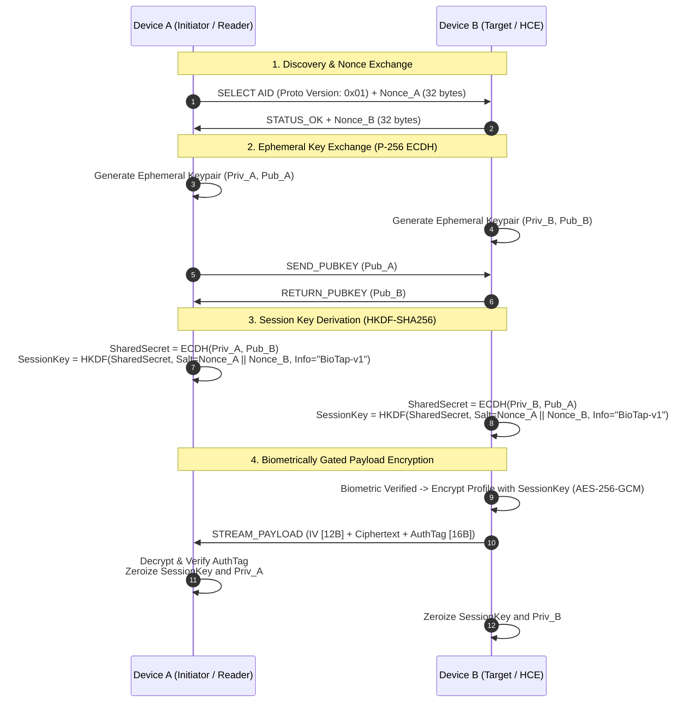

# Security & Cryptographic Architecture

## 1. Threat Model & Security Objectives

In a physical contactless contact sharing ecosystem, the application must defend against several attack vectors:

| Attack Vector                                       | Threat Description                                                                                          | Architectural Mitigation                                                                                                                                          |
| :-------------------------------------------------- | :---------------------------------------------------------------------------------------------------------- | :---------------------------------------------------------------------------------------------------------------------------------------------------------------- |
| **Crowd Skimming / Walk-by Scraping**               | Malicious actor approaches victim in subway/crowd with portable NFC reader to siphon personal contact info. | **Hardware Biometric Gatekeeping**: Private keys cannot sign or decrypt without hardware-enforced biometric authorization token.                                  |
| **Eavesdropping / RF Sniffing**                     | Third party with high-gain directional antenna monitors ambient RF signals during an exchange.              | **Ephemeral ECDH + AES-256-GCM**: Payloads are encrypted on-the-wire with forward secrecy; zero plaintext contact data over RF.                                   |
| **Replay Attacks**                                  | Attacker records APDU packets from a previous exchange and re-transmits them to impersonate a peer.         | **Mutual Cryptographic Nonces**: Each session derives keys using fresh, cryptographically secure 256-bit random nonces exchanged during handshake.                |
| **Physical Device Theft / Data-at-Rest Extraction** | Stolen or seized mobile device subjected to cold-storage memory dump or forensic SQLite extraction.         | **Envelope Encryption with Secure Enclave**: SQLite database is encrypted with a Data Encryption Key (DEK) wrapped by a hardware-backed Key Encryption Key (KEK). |
| **Malicious Payload Injection**                     | Attacker feeds malformed vCard or malicious buffer to exploit memory vulnerabilities or parse engines.      | **Strict Schema Bounds & Sandboxed Serialization**: Strict byte-length limits (≤64KB), memory-safe deserialization, and strict field type validation.             |

---

## 2. Cryptographic Protocol Specification

BioTap Core implements an ephemeral key agreement protocol guaranteeing **Forward Secrecy** and **Mutual Authentication**:



---

## 3. Hardware Root of Trust & Key Hierarchy

All long-term security is anchored in the mobile device's dedicated security processor (Apple Secure Enclave, Android StrongBox / Titan M / TEE).

```
┌────────────────────────────────────────────────────────┐
│ Hardware Isolated Processor (Secure Enclave / StrongBox)│
│                                                        │
│  ┌──────────────────────────────────────────────────┐  │
│  │ Identity Master Key (Device KEK)                │  │
│  │ - Algorithm: EC P-256 or RSA-4096               │  │
│  │ - Key Access: UserPresenceRequired (Biometrics) │  │
│  │ - Hardware Enforced: Non-exportable             │  │
│  └────────────────────────┬─────────────────────────┘  │
└───────────────────────────┼────────────────────────────┘
                            │ Unwraps with Biometric Token
                            ▼
┌────────────────────────────────────────────────────────┐
│ Application Sandbox Memory (Volatile / Transient)      │
│                                                        │
│  ┌──────────────────────────────────────────────────┐  │
│  │ Database Encryption Key (DEK)                    │  │
│  │ - Algorithm: AES-256-GCM                         │  │
│  │ - In-memory only; never committed plaintext     │  │
│  └────────────────────────┬─────────────────────────┘  │
└───────────────────────────┼────────────────────────────┘
                            │ Encrypts / Decrypts
                            ▼
┌────────────────────────────────────────────────────────┐
│ Encrypted Storage at Rest (Local Filesystem)           │
│                                                        │
│  ┌──────────────────────────────────────────────────┐  │
│  │ Encrypted SQLite Database / WAL Journal          │  │
│  │ - Cipher: AES-256-CBC with HMAC or AES-256-GCM   │  │
│  │ - Profile Records, Outbox Sync Queue             │  │
│  └──────────────────────────────────────────────────┘  │
└────────────────────────────────────────────────────────┘
```

---

## 4. Cryptographic Manager Interface Specification

```typescript
// ==========================================
// Cryptographic Manager & Enclave Contracts
// ==========================================

interface CryptoHandle {
  readonly id: string;
  readonly algorithm: string;
  readonly isHardwareBacked: boolean;
}

interface SymmetricKey {
  readonly rawKey: ByteBuffer; // Volatile memory buffer
  zeroize(): void; // Secure memory wiping
}

interface ICryptographicManager {
  /**
   * Initializes or returns the device's hardware-backed Key Encryption Key.
   * Throws if hardware enclave is not present or compromised.
   */
  initializeHardwareMasterKey(): Promise<CryptoHandle>;

  /**
   * Generates a single-use ephemeral P-256 keypair for an active NFC session.
   */
  generateEphemeralKeyPair(): Promise<{
    publicKeyBytes: ByteBuffer;
    privateHandle: CryptoHandle;
  }>;

  /**
   * Performs ECDH key agreement and derives an AES-256 symmetric session key
   * using HKDF-SHA256 with mutual nonces.
   */
  deriveSessionKey(
    localPrivateHandle: CryptoHandle,
    peerPublicKeyBytes: ByteBuffer,
    salt: ByteBuffer,
    info: string,
  ): Promise<SymmetricKey>;

  /**
   * Encrypts plaintext payload using AES-256-GCM.
   */
  encryptAuthenticated(
    plaintext: ByteBuffer,
    key: SymmetricKey,
    associatedData?: ByteBuffer,
  ): Promise<{
    iv: ByteBuffer; // 12 bytes
    ciphertext: ByteBuffer;
    authTag: ByteBuffer; // 16 bytes
  }>;

  /**
   * Decrypts and authenticates ciphertext using AES-256-GCM.
   * Throws CryptoIntegrityError if authentication tag verification fails.
   */
  decryptAuthenticated(
    ciphertext: ByteBuffer,
    iv: ByteBuffer,
    authTag: ByteBuffer,
    key: SymmetricKey,
    associatedData?: ByteBuffer,
  ): Promise<ByteBuffer>;

  /**
   * Unwraps the local SQLite Data Encryption Key (DEK) using the hardware KEK
   * gated by the verified BiometricAuthToken.
   */
  unwrapDatabaseKey(encryptedDek: ByteBuffer, authToken: BiometricAuthToken): Promise<SymmetricKey>;
}
```

---

## 5. Programmable NFC Token (Smart Card / Tag) Security

When interacting with passive physical tokens (e.g., NFC business cards, key fobs, desk badges) rather than active peer devices:

1. **Static vs Dynamic Cryptographic Tags**:
   - **Standard Tags (NTAG213 / NTAG215 / NTAG216)**:
     - Passive NDEF read mode.
     - Payloads written to these tags are signed with the owner's hardware identity key (`Signature_Ed25519(ProfileDigest)`).
     - The receiving BioTap app verifies the digital signature against the owner's public identity key to detect tag tampering.
   - **Advanced Secure Tags (NTAG424 DNA)**:
     - Supports **SUN (Secure Unique NFC)** message authentication.
     - On every physical tap, the tag generates a dynamic AES-128 cryptographic CMAC over the tap counter and tag UID.
     - The BioTap ingestion engine validates the CMAC, preventing cloning of physical smart tokens.

2. **Tamper Prevention & Password Protection**:
   - Writing to programmable tokens requires entering a 32-bit hardware password (`PWD`) and `PACK` (Password Acknowledge) handshake.
   - Lock bits are applied post-provisioning to transition the tag into read-only distribution mode.

---

## 6. Secure Memory Hygiene & Zeroization

To mitigate side-channel memory inspection attacks (e.g., memory dump extraction via debug bridges or jailbroken environments):

1. **Explicit Zeroization**:
   - Symmetric session keys, ephemeral private keys, and decrypted contact buffers implement explicit `zeroize()` routines that overwrite memory buffers with cryptographic zeroes (`0x00`) immediately after use.
2. **Key Pinning in Hardware**:
   - Master private keys never enter user-space application memory; all signing and secret derivation takes place inside the isolated Secure Enclave boundary.
3. **Screenshot & Screen Recording Prevention**:
   - The translucent window host applies OS privacy flags (`FLAG_SECURE` on Android / hidden view hierarchy in task switchers on iOS) to ensure that contact profile details rendered in the assistant sheet are excluded from system screenshots and screen recorders.
