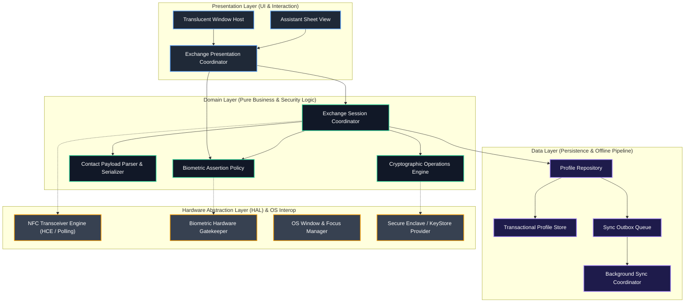
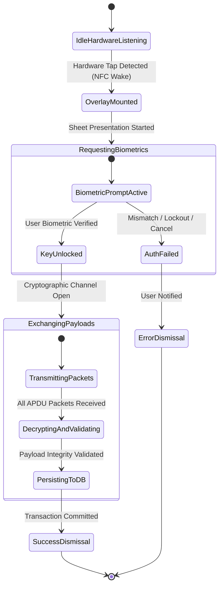

# System Component Architecture & Concurrency Model

## 1. Architectural Philosophy & Layered Boundaries

BioTap Core adheres to a strict **Hexagonal / Clean Architecture** topology, enforcing unidirectional dependencies pointing inward toward core domain logic. Platform-specific operating system APIs (NFC drivers, Biometric frameworks, Window managers, File systems) reside exclusively at the system perimeter behind abstract Hardware Abstraction Layer (HAL) contracts.



---

## 2. Layer Definitions & Responsibilities

### 2.1. Presentation Layer

- **Translucent Window Host (`IOverlayWindowController`)**: Manages the native system window token, translucent window flags (e.g., `FLAG_NOT_TOUCH_MODAL`, `FLAG_LAYOUT_NO_LIMITS`), orientation locking, and backdrop blur/dim level without claiming full-screen focus.
- **Assistant Sheet View**: Renders the sliding bottom drawer, state transitions (idle, authenticating, transferring, success, error), and user confirmation cues.
- **Exchange Presentation Coordinator (`IExchangeViewModel`)**: Consumes Domain state streams and translates them into an immutable `ExchangeViewState` model. Dispatches intent events (e.g., `UserCancelled`, `RetryRequested`) to the Domain coordinator.

### 2.2. Domain Layer

- **Exchange Session Coordinator (`IExchangeCoordinator`)**: State machine orchestrating the complete lifecycle of a single tap-to-share event. Correlates NFC connection lifecycles with biometric authorization states.
- **Cryptographic Operations Engine (`ICryptoEngine`)**: Handles key exchange protocol (ECDH), ephemeral session key derivation (HKDF-SHA256), authenticated encryption (AES-256-GCM / ChaCha20-Poly1305), and digital signature verification.
- **Contact Payload Processor (`IPayloadProcessor`)**: Manages the zero-copy serialization and deserialization of professional profiles (compact binary protobuf / vCard 4.0). Enforces schema sanitization to block malicious or malformed payloads before database injection.
- **Biometric Assertion Policy (`IBiometricPolicy`)**: Enforces temporal freshness rules for hardware biometric tokens (e.g., auth validity window ≤ 5000ms, anti-replay nonces).

### 2.3. Data Layer

- **Profile Repository (`IProfileRepository`)**: Single source of truth for outbound user business cards and ingested contact cards.
- **Transactional Profile Store (`ITransactionalStore`)**: ACID-compliant local database storing encrypted profiles at rest with WAL (Write-Ahead Logging).
- **Sync Outbox Queue (`IOutboxQueue`)**: Persistent message queue holding ingested profiles flagged for background synchronization (e.g., CRM export, cloud backup).
- **Background Job Scheduler (`IBackgroundSyncScheduler`)**: Interfaces with native OS job schedulers (WorkManager / BGTaskScheduler) to defer network I/O until battery, network (unmetered Wi-Fi), and thermal throttling constraints are satisfied.

### 2.4. Hardware Abstraction Layer (HAL)

- **NFC Transceiver Engine (`INfcTransceiver`)**: Bridges native NFC controller events. Operates concurrently in:
  - **Host Card Emulation (HCE) Mode**: Responds to external reader ISO-DEP APDU commands.
  - **Reader / Poller Mode**: Polls external target tokens, exchanges APDUs, and manages RF field coupling.
- **Biometric Gatekeeper (`IBiometricGatekeeper`)**: Wraps OS biometric prompt subsystem, enforcing cryptographic key-unlock binding (CryptoObject / SecAccessControl).
- **Secure Hardware Enclave (`ISecureEnclaveProvider`)**: Direct interface with hardware-isolated Keystore/Secure Enclave for private key generation, signing, and shared secret derivation.

---

## 3. Four-Tier Concurrency Architecture

To guarantee smooth 120 FPS UI animations, sub-100ms NFC latency, and absolute UI responsiveness, execution is partitioned into four isolated concurrency tiers:

```
┌────────────────────────────────────────────────────────────────────────┐
│ Concurrency Tier 1: UI / Main Thread                                  │
│ - Window layout, gesture recognition, Sheet slide-in/out animations    │
│ - Biometric system prompt presentation                                │
│ - Latency budget: ≤ 8.3ms per frame (120 FPS target)                  │
└────────────────────────────────────▲───────────────────────────────────┘
                                     │ State Streams (Unidirectional)
┌────────────────────────────────────┴───────────────────────────────────┐
│ Concurrency Tier 2: Real-Time Hardware I/O Worker (Pinned / High-Pri)  │
│ - NFC ISO-DEP APDU processing loop                                    │
│ - Physical RF frame exchange and handshake                            │
│ - Hard timeout: ≤ 100ms per APDU turn-around to avoid RF decoupling   │
└────────────────────────────────────▲───────────────────────────────────┘
                                     │ Raw Byte Buffers / Nonces
┌────────────────────────────────────┴───────────────────────────────────┐
│ Concurrency Tier 3: Compute & Cryptographic Worker Pool                │
│ - Hardware Keystore / Secure Enclave cryptographic operations          │
│ - Payload compression, vCard parsing, schema sanitization             │
│ - Ephemeral key exchange (ECDH) & AES-256-GCM symmetric decryption    │
└────────────────────────────────────▲───────────────────────────────────┘
                                     │ Sanitized Domain Entities
┌────────────────────────────────────┴───────────────────────────────────┐
│ Concurrency Tier 4: Disk / Persistence Queue (Serialized / Low-Pri)   │
│ - Local database atomic write transactions (ACID / WAL)               │
│ - Outbox queue insertions                                             │
│ - Zero impact on active RF session or sheet animation                  │
└────────────────────────────────────────────────────────────────────────┘
```

### Concurrency Guarantees & Thread Isolation Rules:

1. **Never block Tier 2**: The NFC transceiver loop MUST NEVER await disk I/O, network requests, or UI thread synchronizations. Any bottleneck in Tier 2 will cause the physical user to experience an RF drop ("Tag Lost" error).
2. **Backpressure Decoupling**: Raw NFC byte streams are emitted onto an asynchronous, bounded buffer channel consumed by Tier 3.
3. **Off-Thread Cryptography**: Generating ephemeral keypairs or executing hardware enclave cryptographic operations is executed on Tier 3 workers using non-blocking futures/coroutines.

---

## 4. Language-Agnostic Interface Specifications

Below are the contract definitions (expressed in language-neutral Interface Definition Language / IDL format) establishing the system boundaries.

### 4.1. Hardware Abstraction Layer Interfaces

```typescript
// ==========================================
// 1. NFC Hardware Abstraction
// ==========================================

enum NfcRole {
  EMULATING_TAG, // Host Card Emulation (HCE)
  POLLING_READER, // Active reader / initiator
}

enum NfcSessionState {
  DISCONNECTED,
  RF_FIELD_DETECTED,
  HANDSHAKING,
  TRANSFERRING,
  COMPLETED,
  LOST_CARRIER,
}

interface NfcPacket {
  commandCode: uint8;
  payload: ByteBuffer;
  timestampNano: int64;
}

interface INfcTransceiver {
  // Streams hardware state transitions to domain listeners
  readonly sessionStateStream: AsyncStream<NfcSessionState>;

  // Transceiver execution
  startListening(role: NfcRole): Promise<void>;
  sendApdu(packet: NfcPacket): Promise<NfcPacket>;
  stopListening(): Promise<void>;

  // Closes RF channel immediately
  terminateSession(): void;
}

// ==========================================
// 2. Hardware Biometric Gatekeeper
// ==========================================

enum BiometricStrength {
  CLASS_3_STRONG, // Hardware-backed, cryptographic key unlock
  CLASS_2_WEAK, // Convenience biometric, non-cryptographic
}

interface BiometricPromptConfig {
  title: string;
  subtitle: string;
  allowDeviceCredentialFallback: boolean;
  timeoutMs: int32;
}

interface BiometricAuthToken {
  signedNonce: ByteBuffer;
  cipherHandle: CryptoHandle; // Bound to Secure Enclave key
  authTimestamp: int64;
}

interface IBiometricGatekeeper {
  canAuthenticate(strength: BiometricStrength): Promise<boolean>;

  // Invokes OS biometric prompt, capturing cryptographic handle
  authenticateWithCrypto(
    config: BiometricPromptConfig,
    cryptoHandle: CryptoHandle,
  ): Promise<Result<BiometricAuthToken, BiometricError>>;

  cancelAuthentication(): void;
}

// ==========================================
// 3. Native Window & Overlay Controller
// ==========================================

enum OverlayState {
  HIDDEN,
  ATTACHED_TRANSLUCENT,
  ANIMATING_IN,
  VISIBLE,
  ANIMATING_OUT,
}

interface IOverlayWindowController {
  readonly stateStream: AsyncStream<OverlayState>;

  // Attaches translucent overlay above current background app
  attachTranslucentWindow(): Promise<void>;

  // Animates assistant sheet from bottom screen edge
  presentSheet(): Promise<void>;

  // Dismisses sheet smoothly and tears down overlay window
  dismissSheet(): Promise<void>;

  // Informs window manager of focus requirement for biometric capture
  requestInputFocus(): void;
  releaseInputFocus(): void;
}
```

### 4.2. Cryptographic Subsystem Interfaces

```typescript
// ==========================================
// 4. Secure Enclave & Cryptography Engine
// ==========================================

interface KeyPairDescriptor {
  keyAlias: string;
  algorithm: 'ECDH_P256' | 'Ed25519';
  requiresBiometricUserPresence: boolean;
}

interface EncryptedPayloadBundle {
  ephemeralPublicKey: ByteBuffer; // 65 bytes uncompressed
  initializationVector: ByteBuffer; // 12 bytes for GCM
  ciphertext: ByteBuffer;
  authenticationTag: ByteBuffer; // 16 bytes
  protocolVersion: uint16;
}

interface ICryptoEngine {
  // Generates or retrieves hardware-bound identity keypair
  getOrCreateDeviceIdentity(descriptor: KeyPairDescriptor): Promise<CryptoPublicKey>;

  // Derives ephemeral AES-256 session key using ECDH + HKDF
  deriveSessionKey(
    privateKeyHandle: CryptoHandle,
    peerEphemeralPublicKey: ByteBuffer,
    salt: ByteBuffer,
  ): Promise<SymmetricKey>;

  // Symmetrically encrypts serialized contact payload
  encryptProfilePayload(
    payload: ByteBuffer,
    sessionKey: SymmetricKey,
  ): Promise<EncryptedPayloadBundle>;

  // Decrypts and verifies integrity of peer payload
  decryptProfilePayload(
    bundle: EncryptedPayloadBundle,
    sessionKey: SymmetricKey,
  ): Promise<Result<ByteBuffer, CryptoIntegrityError>>;
}
```

### 4.3. Domain & Data Repository Interfaces

```typescript
// ==========================================
// 5. Contact Payload & Domain Models
// ==========================================

interface ContactProfile {
  id: UUID;
  displayName: string;
  organization: string;
  title: string;
  primaryEmail: string;
  primaryPhone: string;
  avatarThumbnailCompressed: ByteBuffer | null;
  publicVerificationFingerprint: string;
  vCardString: string;
  capturedAtTimestamp: int64;
}

interface IPayloadProcessor {
  serialize(profile: ContactProfile): ByteBuffer;
  deserializeAndValidate(rawBytes: ByteBuffer): Result<ContactProfile, ValidationError>;
}

// ==========================================
// 6. Profile Repository & Offline Outbox
// ==========================================

interface IProfileRepository {
  // Retrieves the local user's active outbound sharing card
  getActiveOutboundCard(): Promise<ContactProfile>;

  // Atomically commits received profile into local database
  saveReceivedProfile(profile: ContactProfile): Promise<void>;

  // Queues profile into outbox queue for deferred cloud/CRM sync
  enqueueSyncTask(profileId: UUID): Promise<void>;
}
```

---

## 5. Reactive State Pipelines & Inversion of Control

The application implements a unidirectional state flow model. The `ExchangeSessionCoordinator` acts as the single orchestrator, consuming events from hardware drivers and emitting immutable states to the presentation layer.



### Inversion of Control (IoC) Dependency Graph:

- **Module Injection**: All components receive dependencies via constructor injection through abstract interfaces.
- **Testability**: The `ExchangeSessionCoordinator` can be executed in a headless JVM/native unit test environment by supplying a mock `INfcTransceiver`, `IBiometricGatekeeper`, and `ICryptoEngine`.
- **Platform Swappability**: Switching platforms (Android NDK, iOS Darwin, Linux Embedded) requires implementing only the HAL layer (`INfcTransceiver`, `IBiometricGatekeeper`, `IOverlayWindowController`, `ISecureEnclaveProvider`) without altering domain exchange protocols or offline persistence queues.
